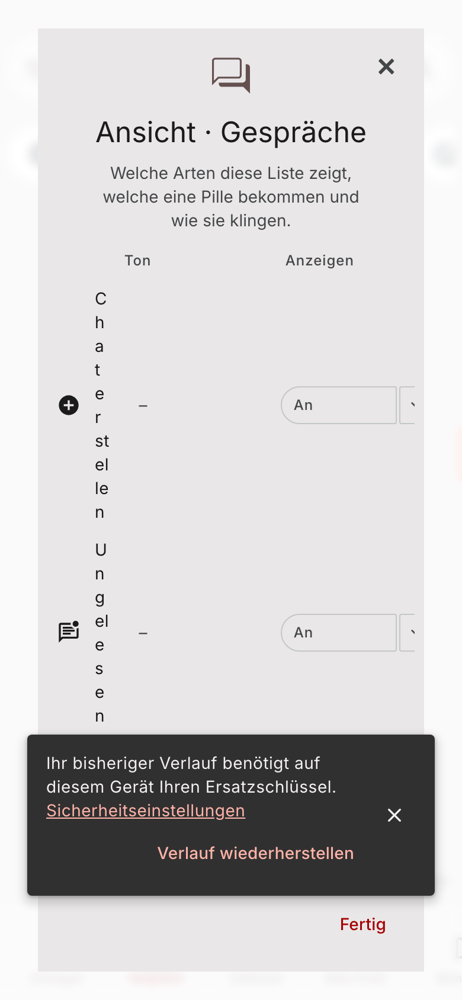
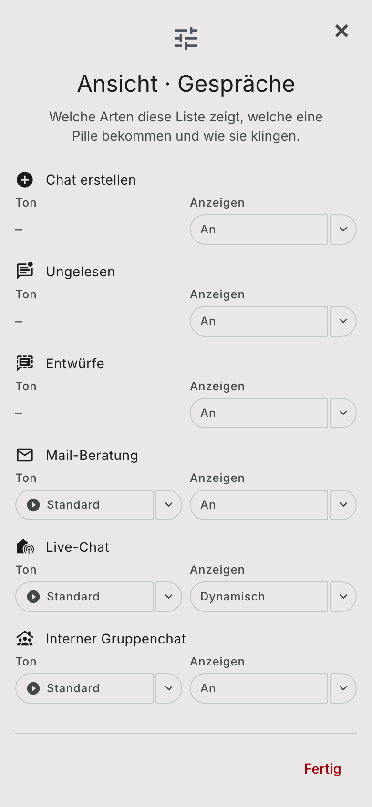
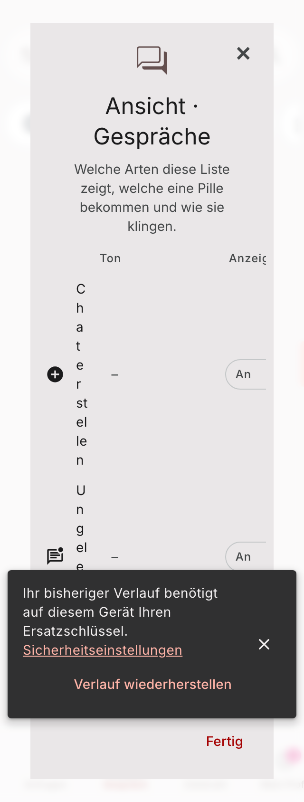
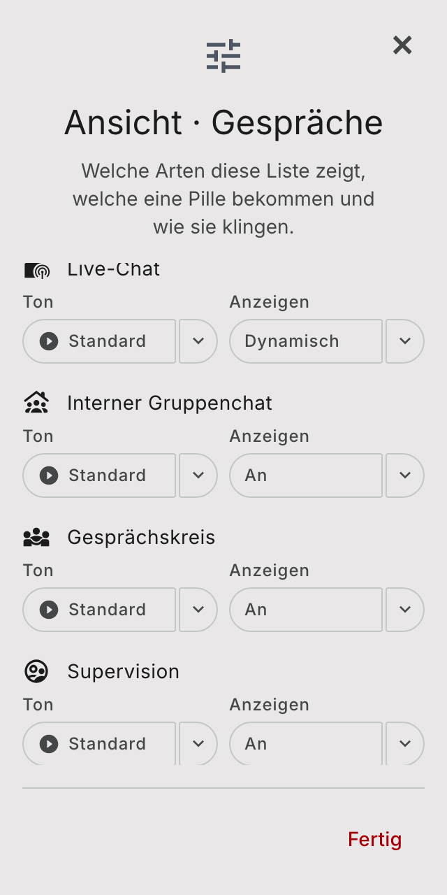
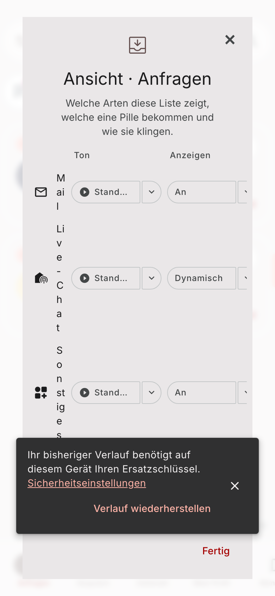
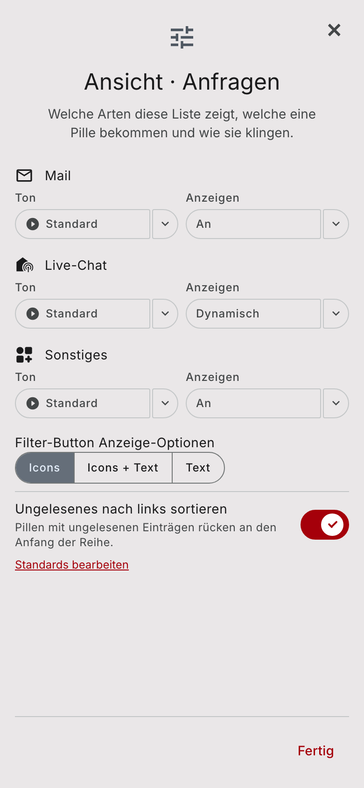
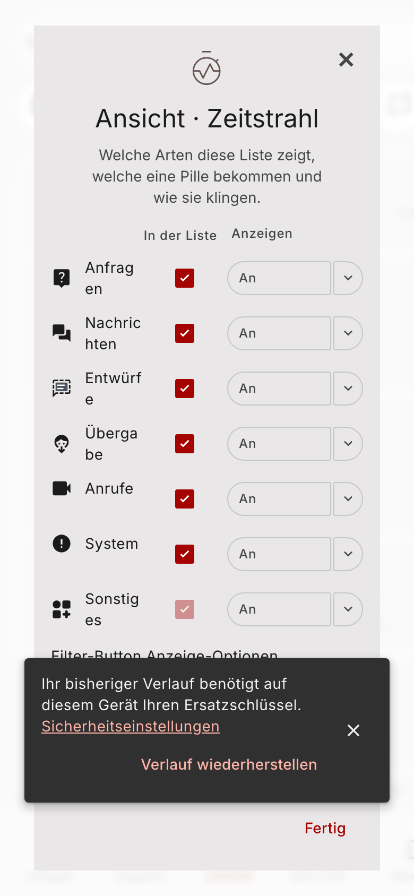
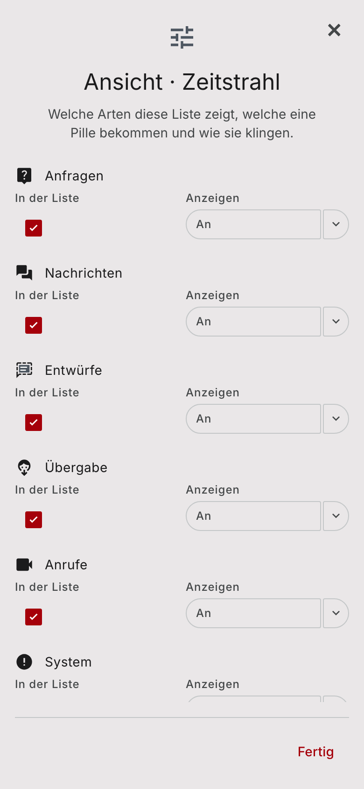

# Display-filter dialog on a phone (#1458)

The "Ansicht" display-filter dialog in Gespräche, Anfragen and Zeitstrahl at phone width.

- **Before:** dev.oriso.org v2.0.12 in a 390 px and 320 px browser window. The table squeezes the kind names into one letter per line and clips the pickers on the right. The dark recovery-key snackbar belongs to the live session, not to this dialog.
- **After:** Storybook `Organisms/DisplayFilterDialog` phone stories at 390 px and 320 px. Below 600 px each kind is a block: icon and name on one line, the labelled pickers underneath. The header icon and the list of kinds come from the story data, not from this change.

These images show the layout only. Desktop staying unchanged is covered by the desktop story and its story test, not by these screenshots.

## Gespräche, 390 px

## Gespräche, 320 px

## Anfragen, 390 px

## Zeitstrahl, 390 px

