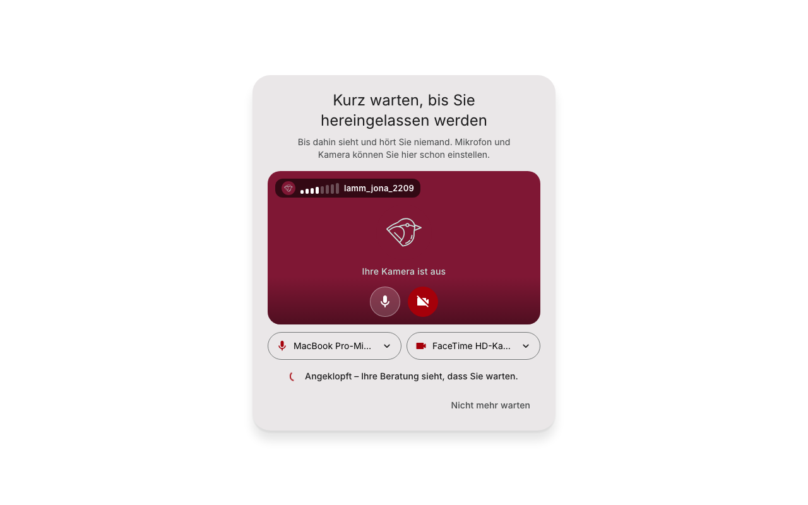

# Call-link guest keeps the animal they picked (#2209)

A guest who enters a running call through its shared link picks an animal on
the link's page. The knock wait used to derive its own animal from the
account id, so the guest saw a different animal while waiting than the one
they had picked. It now shows the picked animal, on the palette derived from
the id, as the call does.




For developers — how these were made and what they do not show:

```text
Story "Entry flows/Knock wait dialog › Call · waiting, camera off · guest
keeps their animal", desktop 1280x800, local Storybook, no backend.
After: avatar = ownAskerAvatar('guest-2209', { avatarId: 'lamb' }), the
expression SharedCallKnock now uses. Before: the same story with the avatar
temporarily set to generateAvatarForUser('guest-2209'), the expression
SharedCallKnock used before this PR; the story was restored afterwards.

Not shown here, covered by unit tests instead:
- the pick is stored on the new account before the call opens, and a
  stalled save no longer holds the guest longer than 5 s
  (DirectLinkCallEntry.test.tsx);
- the device choice, including a change made during registration, reaches
  the call, which opens without Element Call's own lobby
  (DirectLinkCallEntry.test.tsx, SharedCallGuest.test.tsx);
- a guest's call gets the neutral topic "Gespräch" instead of the
  conversation's topic (callHostContext.test.ts); the widget passes it on as
  `orisoTopic`. The title itself is drawn by ORISO-ElementCall, whose proof
  harness has a fixed title and takes no topic, so no screenshot of the title
  exists here.
No live call on Dev was run for these images.
```
