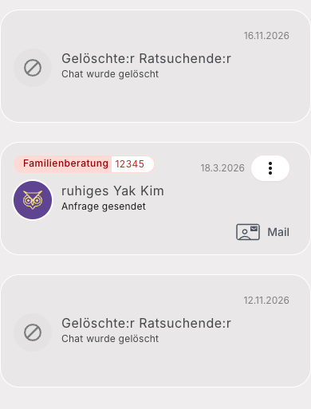
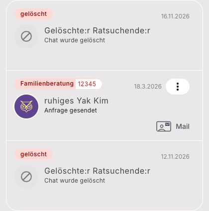
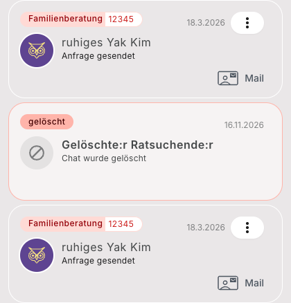
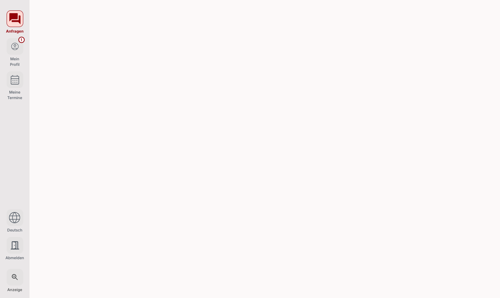
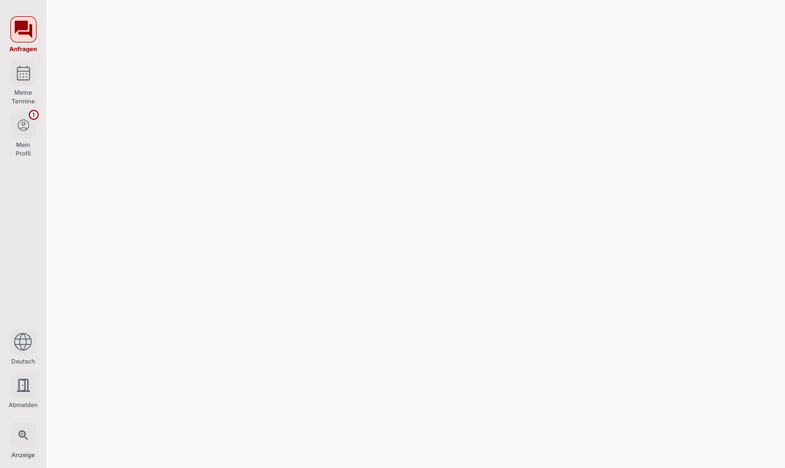

# PR #2538 visual proof

Synthetic Storybook data only. The deleted-card **before** uses both the
component and story from base commit
`8c4c5176a8569efb2ffe37b682c60f69cb8abbab`; the **after** uses the PR
story and component. The navigation **before** uses that base commit's
`RouterConfig.tsx` in the assigned advice-seeker fixture used for the **after**.
The base files were restored to the PR branch before validation. No real
advice-seeker data appears in these captures.

| Before                                                                    | After                                                                    | What the images show                                                                           |
| ------------------------------------------------------------------------- | ------------------------------------------------------------------------ | ---------------------------------------------------------------------------------------------- |
|              |      | The deleted card joins adjacent conversation cards, with a topic fallback chip.                |
| —                                                                         |                  | An opened deleted card separates from its neighbors.                                           |
|  |  | For an assigned advice seeker, “Meine Termine” now precedes “Mein Profil” in the desktop rail. |

The images establish visible layout and order. The group-chat adjacency logic,
topic fallback, and mobile navigation behavior are covered by tests rather than
claimed from these screenshots.
